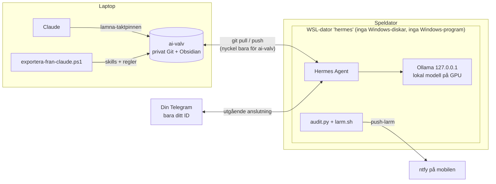

# trygg-ai-kollega

**En självhostad AI-kollega som tar över när Claude-tokens tar slut, och som är byggd säkerhet först.**

Den kör [Hermes Agent](https://github.com/NousResearch/hermes-agent) (öppen källkod, MIT) med en lokal modell via Ollama på en vanlig speldator med RTX 3060. Den delar minne, skills och projektanteckningar med Claude genom ett privat Obsidian-valv i Git. Arbetet går att lämna över åt båda hållen, som en stafettpinne.

> *English summary: a hardened, self-hosted Hermes Agent setup on a gaming PC (WSL2 + Ollama) that shares memory and skills with Claude through a private Obsidian/Git vault, with a threat model, an audit script and push alerts.*

## Idén

Behandla agenten som en **ny kollega med egen dator**. Kollegan får det jobbet kräver och inget mer: inga lösenord, ingen bank, inga privata filer. Den svarar bara dig och frågar alltid innan den gör något som inte går att ångra.



## Vad som ingår

| Del | Fil |
|---|---|
| Hotmodell, avvägningar och checklista | [`SAKERHET.md`](SAKERHET.md) |
| Windows-steg: brandvägg, egen WSL-dator, Tailscale, GPU-gräns | [`install/01-windows.ps1`](install/01-windows.ps1) |
| WSL-steg: Ollama, Hermes, härdning, hemligheter, valv | [`install/02-wsl.sh`](install/02-wsl.sh) |
| Härdade Hermes-inställningar | [`config/hardening.yaml`](config/hardening.yaml) |
| Kollegans identitet och gränser | [`config/SOUL.md`](config/SOUL.md) |
| Säkerhetskontroll (läser bara, larmar vid rött) | [`scripts/audit.py`](scripts/audit.py) |
| Push-larm vid misstänkta händelser | [`scripts/larm.sh`](scripts/larm.sh) |
| Start i tmux, spelläge | [`scripts/starta.sh`](scripts/starta.sh), [`install/pausa-kollegan.ps1`](install/pausa-kollegan.ps1) |
| Export av skills och regler från Claude | [`scripts/exportera-fran-claude.ps1`](scripts/exportera-fran-claude.ps1) |
| Skills för överlämning, utveckling och säkerhet | [`skills/`](skills) |
| Mall för det delade valvet | [`valv-mall/`](valv-mall) |

## Kom igång

**På speldatorn, i PowerShell som administratör:**
```powershell
git clone https://github.com/andersvlindberg/trygg-ai-kollega.git
cd trygg-ai-kollega
powershell -ExecutionPolicy Bypass -File .\install\01-windows.ps1
```

**I den nya WSL-datorn** (`wsl -d hermes`):
```bash
git clone https://github.com/andersvlindberg/trygg-ai-kollega.git ~/trygg-ai-kollega
bash ~/trygg-ai-kollega/install/02-wsl.sh
bash ~/trygg-ai-kollega/scripts/starta.sh
```

Varje steg frågar innan det gör något. Efteråt ska `python3 scripts/audit.py` visa 0 röda.

## Stafettpinnen

1. **Claude → Hermes:** när tokens tar slut ber du Claude om `lamna-taktpinnen`. Läget skrivs till `ai-valv/00-start/HANDOFF.md` och pushas.
2. Skriv till kollegan på Telegram. Den kör `ta-emot-taktpinnen`, sammanfattar läget och frågar innan den fortsätter.
3. **Hermes → Claude:** kollegan avslutar med `lamna-taktpinnen`. Svåra uppgifter hamnar under "Till Claude". Nästa gång du öppnar Claude säger du "ta emot taktpinnen".

Det är inte samma konversation. Ingen modell kan läsa en annans chatthistorik, men allt som behövs för att fortsätta finns i valvet.

## Modellval för 12 GB VRAM

| Modell | Passar till | Kommentar |
|---|---|---|
| `hermes3:8b` (standard) | Allmänt, verktygsanrop | Tränad av Nous för function calling |
| `qwen2.5-coder:7b` | Kod | Bra kodkvalitet för storleken |
| `gemma3:12b` | Text och resonemang | Kräver mer VRAM vid 32K kontext |

Hermes kräver minst 32K kontext. En lokal 8B-modell är **betydligt svagare** än Claude. Använd den för rutinjobb och spara det svåra till Claude, eller lägg till en API-nyckel för tyngre jobb.

## Vad som följer med från Claude

| Följer med | Hur |
|---|---|
| Egna skills, Data Academy och utvecklingsskills (superpowers) | `exportera-fran-claude.ps1` → `ai-valv/skills` → `skills.external_dirs` |
| Regler (CLAUDE.md) | Kopieras till `ai-valv/regler/` |
| Minne och projekt | Markdown i `ai-valv/minne` och `ai-valv/projekt` |
| Pågående arbete | `HANDOFF.md` |
| **Följer inte med:** Anthropics inbyggda skills (docx, pptx m.fl.) och Claude Code-moddar | De får bara användas i Claude respektive är UI-tillägg för Claude Code |

## Färdplan

- [x] Härdad Hermes i egen WSL-dator, delat valv, audit och larm
- [ ] **Fjärrstart och fjärrstyrning:** väck speldatorn från mobilen och låt Claude eller Hermes arbeta på den. Plan: [`docs/fjarrstart.md`](docs/fjarrstart.md)
- [ ] GPG-kryptering av känsliga filer i valvet och krypterade backuper
- [ ] Separat larmbot som bara tar emot larm
- [ ] Överlämningar via en egen gren med granskning innan merge
- [ ] CI som kör `audit.py` och tester på varje pull request

## Licens

MIT. Se [LICENSE](LICENSE).
