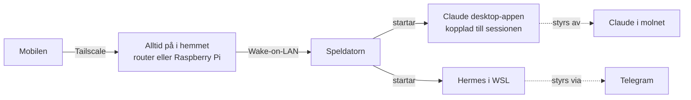

# Fjärrstart och fjärrstyrning

**Status:** planerad, inte byggd än.

**Mål:** starta speldatorn från mobilen när jag inte är hemma, och låta Claude eller Hermes arbeta på den, med samma säkerhetstänk som resten av repot.

## Del 1: Starta datorn på distans

- [ ] Slå på **Wake-on-LAN** i BIOS/UEFI (heter ofta *Wake on LAN*, *Power On By PCI-E* eller *Resume by LAN*).
- [ ] I Windows: Enhetshanteraren → nätverkskortet → Energisparfunktioner: tillåt att enheten väcker datorn, och bara via magiskt paket. Stäng av **Snabbstart** under Energialternativ, eftersom den ofta stoppar Wake-on-LAN.
- [ ] Koppla datorn med **nätverkskabel**. Väckning via wifi fungerar sällan pålitligt.
- [ ] Notera nätverkskortets MAC-adress (`getmac /v` i PowerShell). Den behövs för väckningen.
- [ ] Välj vad som skickar väckningssignalen inifrån hemnätet:
  - **Routern**, om den har en inbyggd funktion för att väcka enheter som går att nå på distans.
  - **En Raspberry Pi eller liknande** som alltid är på och har Tailscale. Från mobilen: `ssh pi` via Tailscale och `wakeonlan <MAC>`, eller en enkel knapp i en webbsida som bara nås via Tailscale.
  - **Reserv:** smart kontakt plus BIOS-inställningen *Restore on AC Power Loss = Power On*.
- [ ] Testa: stäng av datorn, väck den från mobilen på 4G (inte hemma-wifi).

## Del 2: Styrning när den är igång

- [ ] Installera Claude desktop-appen och låt den starta med Windows.
- [ ] Koppla datorn till Claude-sessioner (samma sätt som laptopen).
- [ ] Ge åtkomst bara till de mappar som behövs, till exempel `Documents\GitHub` och `ai-valv`. Inte hela hemkatalogen.
- [ ] Låt Hermes starta automatiskt i WSL (`scripts/starta.sh` via en schemalagd uppgift vid inloggning).
- [ ] Energiinställningar: ingen viloläge medan arbete pågår, viloläge efter till exempel 60 minuter utan aktivitet.
- [ ] Testa hela kedjan: väck, vänta tills Claude-appen är online, låt Claude köra ett kommando, låt datorn somna igen.

## Del 3: Säkerhet

| Risk | Motåtgärd |
|---|---|
| Någon annan väcker eller når datorn | Allt bara via Tailscale. Inga öppna portar mot internet. Tvåstegsverifiering på Tailscale-kontot. |
| Datorn står inloggad och olåst | Behåll BitLocker och PIN. Föredra att bakgrundstjänster körs medan skärmen är låst. Automatisk inloggning bara om det verkligen behövs, och då med ett separat Windows-konto. |
| AI:n kommer åt privata filer | Begränsa mappar. Lösenord, bank och personliga dokument ligger utanför de mappar som delas. |
| Något drastiskt händer när ingen tittar | Godkännanden som i Hermes. Inget raderas, publiceras eller skickas utan ja. |
| Raspberry Pi blir en svag länk | Bara Tailscale, ingen lösenordsinloggning (SSH-nyckel), automatiska säkerhetsuppdateringar. |
| Datorn slits eller blir varm | Viloläge efter inaktivitet, GPU-effektgräns, `pausa-kollegan.ps1` vid spel. |

## Begränsningar

- En helt strömlös dator kan bara startas med smart kontakt eller Wake-on-LAN via kabel.
- Skärmstyrning kan kräva att Windows är inloggat. Kommandon och filer fungerar oftast ändå.
- Windows-uppdateringar kan starta om datorn. Planera uppdateringstider.

## När det är klart

Uppdatera `SAKERHET.md` med de nya riskerna och flytta den här planen till "Vad som ingår" i README.
